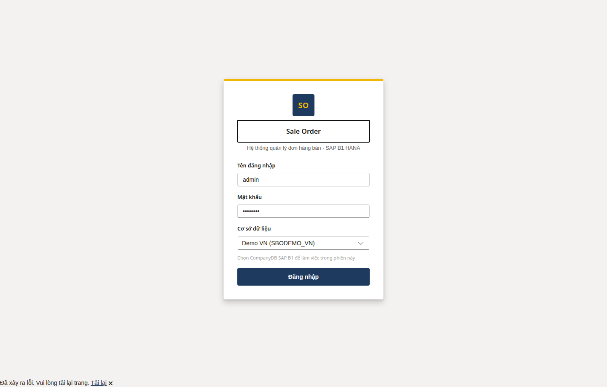
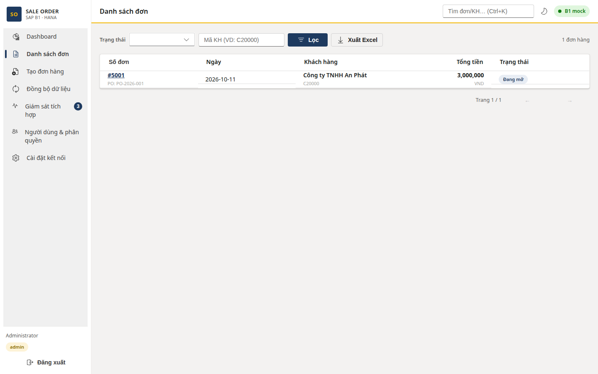
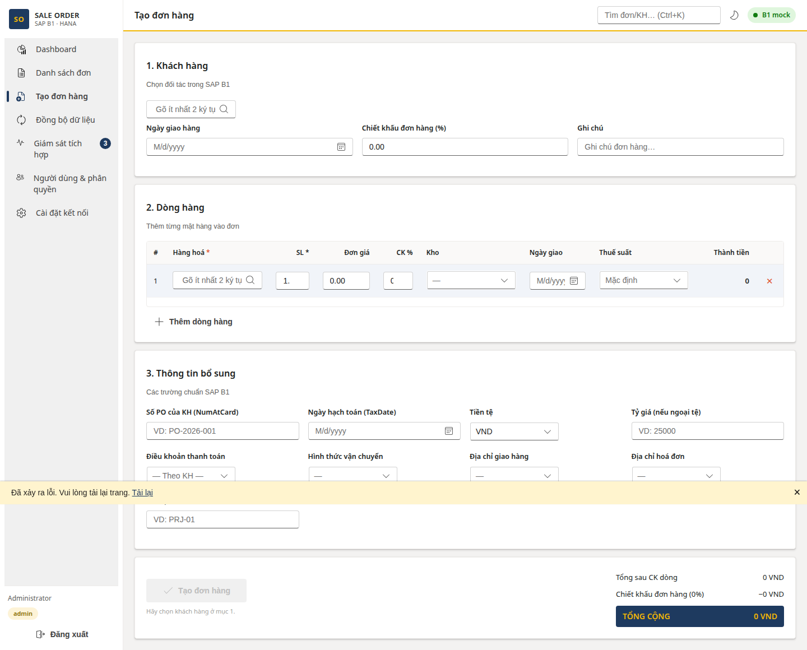
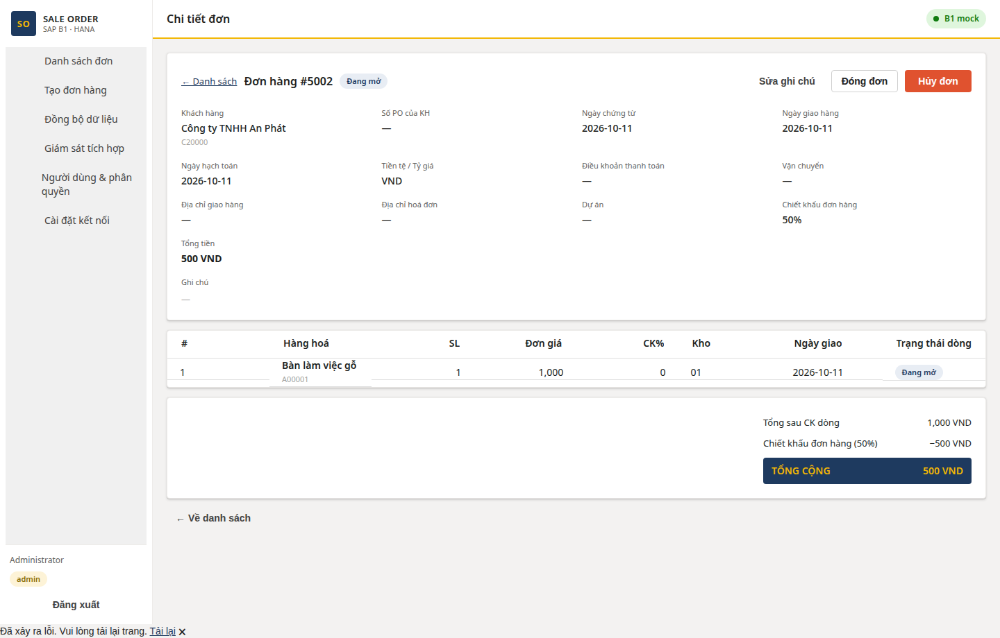
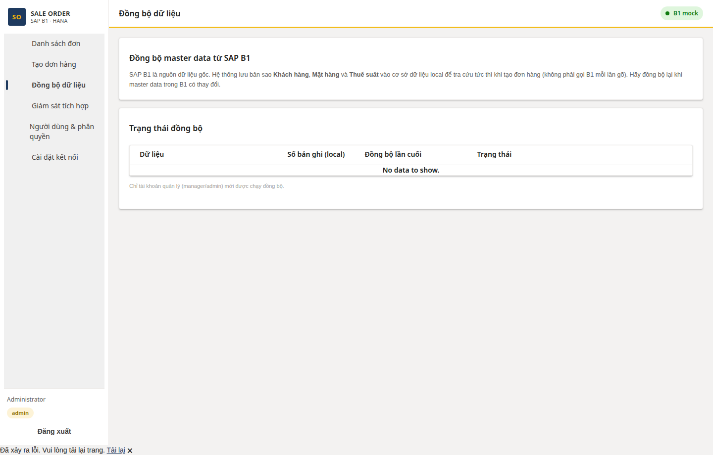
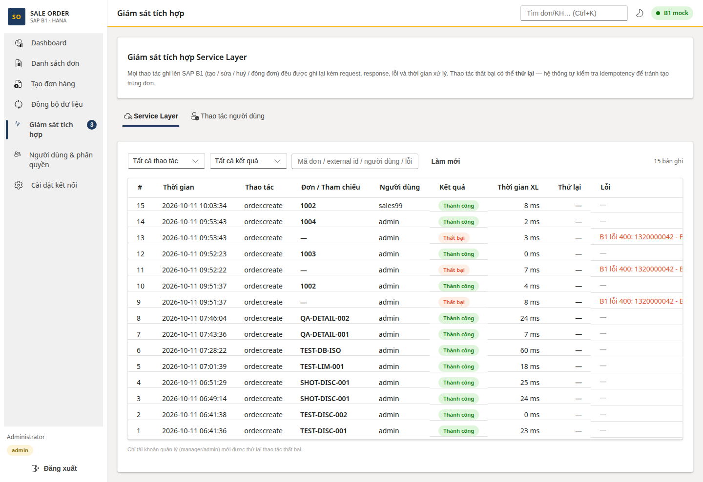
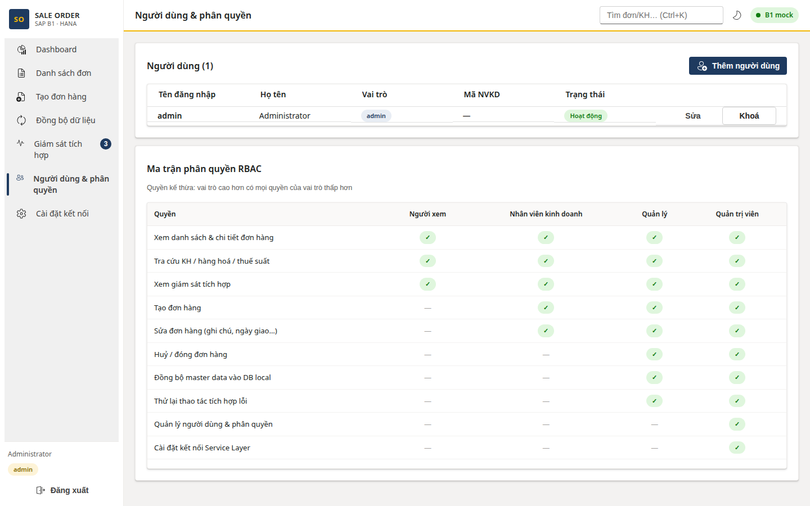
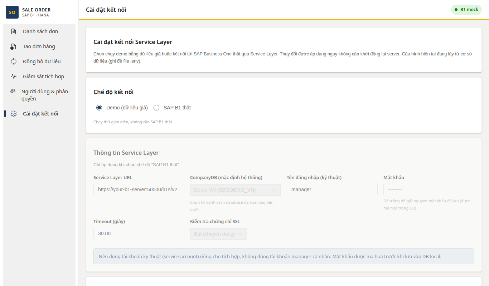

# Sale Order — SAP B1 Web App (ASP.NET Core + Blazor)

Web quản lý đơn hàng bán SAP Business One (HANA) qua Service Layer.

- **Backend + Frontend chung một app**: ASP.NET Core API + Blazor WebAssembly (hosted), không tách backend
- **UI**: FluentBlazor 5.0, palette navy `#1E3A5F` / gold `#F2B705` / coral `#E0522F`
- **Chế độ mock mặc định** (chưa cần SAP thật): `B1_MOCK=true`

## Chạy nhanh (mock)

```bash
dotnet run --project SalesWeb.Server --urls http://localhost:5050
```

Mở http://localhost:5050 — đăng nhập `admin` / `admin123`.

## Kết nối SAP B1 thật

Vào **Cài đặt kết nối** (quyền admin) trong app, hoặc biến môi trường:

```bash
B1_MOCK=false B1_BASE_URL=https://<hana>:50000 B1_COMPANY_DB=SBODemoVN \
B1_USERNAME=manager B1_PASSWORD=*** dotnet run --project SalesWeb.Server
```

## Docker

Xem [DEPLOY-DOCKER.md](DEPLOY-DOCKER.md).

```bash
docker compose up -d --build   # http://localhost:8080
```

## Tính năng

- CRUD đơn hàng bán (idempotent theo `external_id`, sửa có ETag, hủy/đóng dòng)
- **Chiết khấu dòng và chiết khấu đơn hàng** (ánh xạ `RDR1.DiscPrcnt` / `ORDR.DiscPrcnt`), breakdown tổng tiền chi tiết
- **Ngưỡng chiết khấu theo vai trò**, admin tự cấu hình trong màn Cài đặt (sales/manager, admin không giới hạn)
- Tra cứu KH / hàng hóa / kho / thuế suất, autocomplete
- Đồng bộ master data vào SQLite local (`POST /api/sync`)
- Audit mọi thao tác Service Layer + retry thông minh (`/audit`)
- Auth JWT + RBAC 4 cấp: viewer < sales < manager < admin
- Cài đặt kết nối B1 runtime (mật khẩu mã hóa AES-GCM), quản lý user

## Màn hình

### Đăng nhập


### Danh sách đơn hàng


### Tạo đơn hàng (chiết khấu dòng + chiết khấu đơn hàng)


### Chi tiết đơn hàng (chiết khấu + breakdown tổng tiền)


### Đồng bộ dữ liệu


### Giám sát tích hợp


### Người dùng & phân quyền


### Cài đặt kết nối (ngưỡng chiết khấu theo vai trò)


## Cấu trúc

```
SalesWeb.Shared/   DTO dùng chung (JSON snake_case)
SalesWeb.Server/   ASP.NET Core API + phục vụ Blazor
SalesWeb.Client/   Blazor WebAssembly + FluentBlazor (8 trang)
```

## Tài liệu kỹ thuật

- [Thiết kế giải pháp chi tiết](docs/thiet-ke-giai-phap.md) — kiến trúc, tích hợp Service Layer, chiết khấu, đa database
- [API payload chi tiết](docs/api-payload-chi-tiet.md) — endpoint, request/response từng API
- [Màn hình — Sự kiện — API](docs/man-hinh-su-kien-api.md) — chi tiết từng màn hình và sự kiện
- [Báo cáo QA UI/UX](docs/bao-cao-qa-ui-ux.md) — kết quả kiểm thử giao diện
